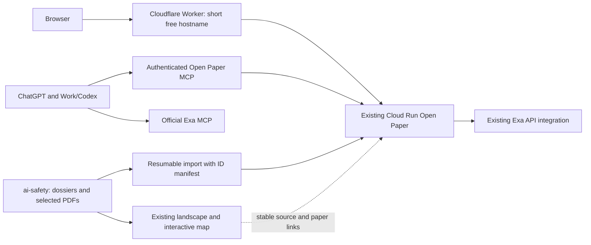

# Strategy: personal research ecosystem

Date: 2026-11-03. Status: approved by operator with ‘proceed accordingly’; implementation tracked in INTENT-research-ecosystem.md.
Branch inspected: `feat/cloud-run-personal`, HEAD `ffc3e6bcc4a2`.

## Outcome and confirmed preferences

Use Open Paper for reading, cited conversations and paper notes; ChatGPT for
brainstorming; Exa for discovery; and `../ai-safety` for versioned research records.
Reuse existing features and preserve evidence provenance.

The operator confirmed: no owned domain, prefer a short free hostname; ChatGPT
Business/Enterprise access, for both regular ChatGPT and Work/Codex; Exa API
account with credits. Exact ChatGPT tier and workspace administration rights are
not yet established. Requested development workflow: GPT-6.1 Sol at high effort
for strategy, then GPT-6.1 Terra for execution. This record does not claim a model
switch occurred or that the deployed app's Gemini provider should change.

## Proposed architecture

MCP and the landscape integration are proposed additions. They do not exist in
the inspected application yet. Cloud Run, Neon, GCS and Vertex AI stay in place.

## 1. Short hostname

Recommend a thin Cloudflare Worker proxy using
`<worker>.<account-subdomain>.workers.dev`, for example
`papers.<chosen-subdomain>.workers.dev` if available. The name has not been
reserved or checked. Cloudflare documents workers.dev for personal/hobby use.
A purchased domain can be attached later without moving the application.

Firebase Hosting offers `<site>.web.app`, but its Cloud Run rewrite strips all
request cookies except `__session`; this app uses `session_token`. Hosting also
has a 60-second request timeout. It would require auth compatibility changes and
streaming checks, so it is not the preferred front door.

Implementation must treat the hostname as an origin migration:

- Preserve one browser origin for Next.js and `/api`, and stream bodies through
  the Worker. Validate cookie scope, OAuth state and redirects end to end.
- Add a configurable public origin to deployment scripts. `public_url()` now
  computes run.app unconditionally; a DNS/proxy change alone is insufficient.
  Rebuild the client with the public URL and update server origins, Google OAuth
  redirect registration and GCS CORS. Keep the Cloud Run origin separately.
- Route internal Cloud Tasks, Scheduler and job callbacks directly to Cloud Run
  where appropriate; do not add the public edge to the job delivery dependency.
  Inspect how callback URLs are constructed before changing `API_DOMAIN`.
- Bypass caching for authenticated pages, API, OAuth and MCP. Forward cookies
  and authorization; use the correct upstream host and trusted forwarded origin.
  Keep the proxy restricted to the configured Cloud Run upstream.

Acceptance: login/logout and idle login, PDF upload/render, cited chat streaming
and a response lasting beyond 60 seconds all work through the new hostname;
browser API traffic and redirects remain on that hostname.

## 2. ChatGPT connection and note ownership

Build a small remote MCP adapter over existing application services, with
streamable HTTP and OAuth. Reuse an established MCP/OAuth implementation;
existing Google browser login is not itself an MCP authorization server.
The old P5 assumption of a manually supplied bearer token needs revision:
the documented ChatGPT custom-server UI lists OAuth, no auth, or mixed auth,
not a generic static bearer-token field. API tokens may still suit Codex clients.
Check workspace permissions and server registration in the actual account.

First tools: `search_papers`, `get_paper`, `list_projects`, `get_paper_note`,
`list_annotations`, then `append_paper_note` with a retry-safe request ID and
protection against concurrent edits. Enforce the authenticated user's access
through the existing services. Start with read access before exercising writes.

Brainstorm in ChatGPT with retrieved paper context, then explicitly save chosen
material. MCP is a tool connection, not automatic synchronization of chat history.
Paper-specific notes can use the existing PaperNote; the model permits only one
note per paper and updates replace its content. An append tool must preserve
existing text. Do not import a dossier by blindly overwriting an existing note.
Verify the active note editor and content format before import; storage is Text,
which does not alone establish Markdown rendering.

General project-level idea notes need a deliberate destination. Initially retain
canonical B01–B17 records in `ai-safety/.../brainstorming/ideas.json` and related
Markdown. Export selected ChatGPT ideas there through a reviewed local workflow.
There is no demonstrated generic project-note API: project artifacts inspected
are chart/citation artifacts, and annotations require highlights. Do not disguise
general ideas as paper annotations. Add a small project-note capability later
only if this workflow proves awkward.

ChatGPT interaction uses the subscription's product allowance. Calls made by the
deployed application use provider/API billing. Current official documentation
also offers claimable API credits to eligible Pro and Business owners; Business
and Enterprise differ, and Enterprise is explicitly ineligible for this benefit.
Check exact tier, ownership and credit grant before considering OpenAI inside the
app. Keep working Vertex AI as the baseline rather than making this a dependency.

Acceptance: retrieve an owned paper with its citation/source link from both
clients; an explicit save is visible in Open Paper; repeated save requests do
not duplicate content; another identity cannot retrieve or edit the paper.

## 3. Exa credits

Reuse `server/app/helpers/exa_search.py` and the existing web-search tool.
The helper already accepts `EXA_API_KEY`, uses publication/web search and retries
transient errors. Deployment currently does not wire that key into the service.
Add it through Secret Manager and the existing secret-input workflow, with no
local secret file. Validate one bounded search and check the Exa usage dashboard.
The existing scrape tool separately uses Firecrawl: enabling Exa does not enable
that tool. Exa fetch integration can replace this dependency in a later bounded
change if full web reading is needed.

For discovery directly in ChatGPT/Work/Codex, prefer Exa's official MCP rather than
writing another search wrapper. The documented OAuth URL is
`https://mcp.exa.ai/mcp?login`; authenticated usage belongs to the Exa team.
Keyless access has separate free limits and does not demonstrate that paid
credits are being used. Avoid running the same search through both integrations.
Choose request/result caps and a spending ceiling before a collection run;
this strategy does not authorize a bulk paid search.

## 4. Corpus import

Read-only inventory: 48 dossier Markdown files; two local PDFs (a paper and the
Apart sprint report); landscape exports with 3,598 sources, 101 entities,
4,328 source-topic rows, 13 relations and zero claims; 17 brainstorming ideas.
These are different kinds of records. A discovered source is not necessarily a
paper, a verified classification, or available full text.

Start with a dry-run manifest for the curated dossiers, including stable dossier
ID, canonical URL, DOI/arXiv/version where present, local PDF/hash, target project,
read status, provenance, Open Paper paper/job IDs and terminal outcome. Resolve
DOIs and URLs too: some dossiers have no arXiv ID. Keep the sprint report distinct
from published literature.

Pilot three representative items: local PDF, arXiv URL, non-arXiv paper. Use the
existing `/api/paper/upload/from-url/` and file upload, then project membership,
tags and paper notes. Save the authored dossier separately from the generated
AI summary and preserve stub/speculation/review labels. Resume by manifest and
canonical identity; do not assume upload-by-URL deduplicates.

Only expand after checking terminal processing outcomes, metadata, preserved
notes, PDF view and cited project chat. Unavailable PDFs remain explicit skips,
not synthetic papers. Do not mass-process all 3,598 landscape URLs with Gemini.

## 5. Knowledge graph reuse

The built-in `/graph` is OpenAlex citation/author browsing through
`/api/search/global/match` and `/author`. It is not a general importable semantic
graph. Reuse it for scholarly references and cited-by navigation.

Retain the existing `explore.html`, `graph.json`, GraphML and portable JSONL
exports for topic/source/idea relations. The current exports contain zero
evidence claims; schema support must not be presented as populated knowledge.
Reuse existing local full-text search and map generation instead of adding a
graph database or regenerating the landscape with an LLM.

Bridge the two with a versioned mapping from dossier/source IDs and canonical
DOI/URL to Open Paper IDs. Add links from the map to imported papers and from
paper notes/project description to the map. Keep a hosted map private if hosted;
initial use can remain local. Preserve labels distinguishing discovery,
editorial relation and speculation. Tags aid navigation but cannot preserve all
edge semantics. Consider a narrow read-only landscape query adapter for MCP
after the paper workflow is useful; preserve the existing schema and provenance.

## Execution order and unresolved decisions

1. Reliability baseline: recommend durable, idempotent delivery of PDF and
   data-table outcomes before bulk import. A bounded retry loop is insufficient
   across an outage. A delivery-only task with persisted outcome is a candidate;
   do not retry expensive Gemini processing just to redeliver its result.
   The operator has not accepted the current loss case. Keep review `rework`.
2. Short hostname, origin migration, and login/streaming verification. Preserve
   the pending week-long billing check; it need not block local manifest work.
3. Exa secret wiring plus one bounded verification search.
4. Import manifest, three-item pilot, then approved curated batch.
5. Open Paper OAuth MCP: retrieval, then explicit paper-note saving.
6. Landscape links and optional read-only graph queries; evaluate project notes.

Use Sol 6.1 high for strategy and bounded intent, then Terra 6.1 for execution
against observable checks. Escalate architectural uncertainty to Sol. This is a
development-model policy, separate from Open Paper's inference provider. The
current strategy task does not launch implementation agents or change settings.

Unknowns that can change the direction: available workers.dev account/name;
exact ChatGPT tier and admin rights; OAuth implementation fit; desired home for
general notes; note editor behavior; import pilot results; acceptable outage
policy and Exa/import spending caps. Firebase becomes an alternative if its
cookie and timeout constraints are deliberately accommodated. Broader graph
integration becomes justified only by concrete questions the existing map and
citation view cannot answer.

## Evidence and sources

Repository inspection, not a live deployment test: `deploy/deploy.sh`,
`deploy/service.openpaper.yaml`, `server/app/helpers/exa_search.py`,
`server/app/llm/tools/web_tools.py`, `server/app/api/paper_upload_api.py`,
`server/app/api/paper_api.py`, `server/app/database/models.py`,
`client/src/app/(main)/(protected)/graph/page.tsx`; adjacent landscape README,
manifest, graph and ideas files. Prior P3 evidence remains in `current.json`.

External documentation checked 2026-11-03:

- [Cloudflare workers.dev](https://developers.cloudflare.com/workers/configuration/routing/workers-dev/)
- [Cloudflare cache bypass](https://developers.cloudflare.com/changelog/post/2024-11-11-cache-no-store/)
- [Firebase cookie handling](https://firebase.google.com/docs/hosting/manage-cache)
- [Firebase Cloud Run rewrites and timeout](https://firebase.google.com/docs/hosting/cloud-run)
- [ChatGPT custom MCP setup and authentication](https://developers.openai.com/api/docs/guides/custom-mcp-server)
- [Work/Codex MCP settings](https://learn.chatgpt.com/docs/developer-settings)
- [Subscription API credit eligibility](https://developers.openai.com/api/docs/guides/chatgpt-api-credits)
- [Exa official MCP and authentication](https://exa.ai/docs/get-started/exa-mcp)

## ChatGPT integration expansion proposal — 2026-11-04

Status: first release approved by operator with “proceed accordingly” and
deployed as openpaper-00008-lxc; account-side new-tool acceptance pending.
Later phases remain proposals; no paid search or corpus expansion ran. Current MCP exposes seven tools: metadata search, paper
metadata/text, project listing, notes, annotation listing and note append.

Recommended order:
1. Grounded retrieval: expose existing indexed passage search with bounded
   excerpts, stable IDs, page/offset provenance and project filters; enrich
   highlight/annotation context and project membership reads. Add standard
   search/fetch compatibility alongside custom tools for ChatGPT research use.
2. Persistent context and writes: complete live note-append acceptance, add
   project context/session briefs and retry-safe project organization operations.
   Keep general hypotheses/experiment records canonical in ai-safety; first
   offer reviewed exports instead of introducing competing project-note storage.
3. Explicit discovery/import: reuse Exa with result/spend caps; import only
   user-selected sources through identity reconciliation and resumable jobs.
4. Landscape/idea bridge: narrow read-only query adapter over existing exports
   and stable corpus mappings; preserve authored relation/epistemic labels.
5. Optional ChatGPT UI for source previews and evidence tables after the tool
   workflow demonstrates value; this is a separate integration surface.

Observable first release: retrieve an owner/project-authorized passage that
is absent from metadata; resolve its citation against actual PDF text; recover
project context in a fresh chat; explicitly save chosen paper notes and read
them back without duplicate append. No claim that all are currently supported.

Material unknowns: account-specific research-mode compatibility, live MCP
write acceptance, project-collaborator read policy, passage-index coverage and
PDF page mapping accuracy. Semantic search/embeddings are conditional on
measured lexical retrieval failures. Reconsider project-note storage only if
reviewed repository exports prove too cumbersome; reconsider new infrastructure
only after concrete retrieval/evaluation evidence warrants it.

Official documentation checked: https://developers.openai.com/api/docs/mcp
(search/fetch compatibility for ChatGPT deep research/company knowledge) and
https://developers.openai.com/api/docs/guides/custom-mcp-server
(custom tool use and write confirmation). This is compatibility guidance,
not proof of availability in the operator's particular workspace/mode.

## Research workspaces and architecture assessment — 2026-11-04

The operator requested productive use of the remaining Codex allowance and
selected all three priorities: research enrichment, local project workspaces,
and reliability. The current assessment and staged implementation proposal are
in [Project workspaces, research enrichment, and fork architecture](STRATEGY-project-workspaces-and-research.md).
That record supersedes earlier future-tense capability descriptions where the
capabilities have since shipped. It distinguishes 15 tools in current server
source from seven exposed in this conversation, and preserves outstanding live
acceptance. The recommended local model binds OpenPaper project UUIDs to research
directories while retaining shared dossiers and canonical research records in
ai-safety. No new implementation, corpus expansion or paid run occurred in this
strategy pass. Concrete maintenance/import/CI findings precede broader additions.
